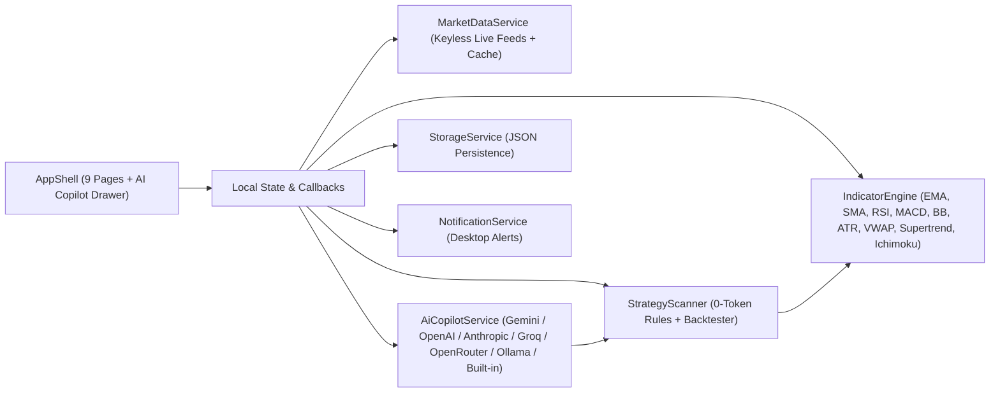
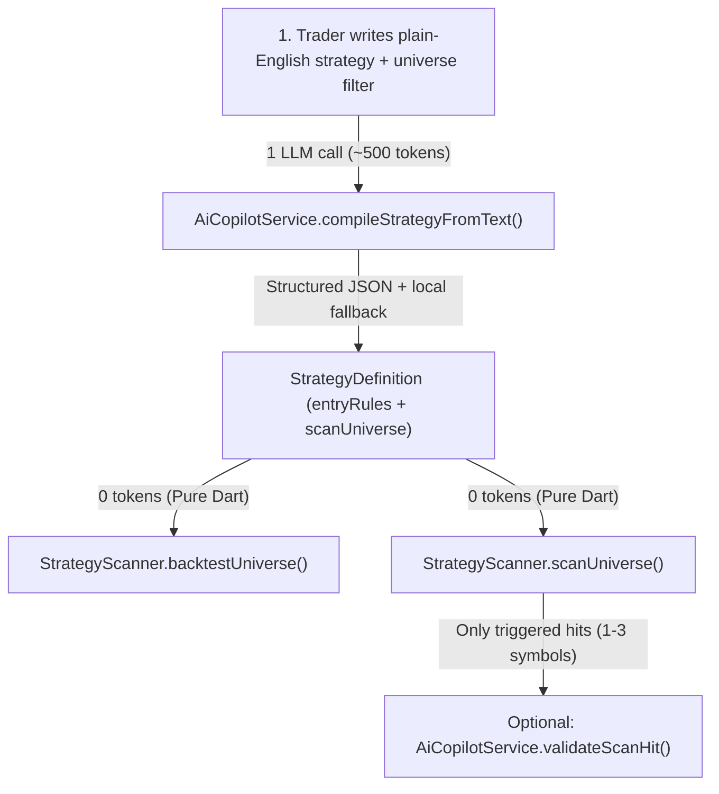

# Flutter Desktop Workstation Guide (`desktop/`)

The **Quantum Trading Platform Desktop App** (`desktop/`, `trading_platform` v2.0.1+1) is a standalone **Flutter Linux/Desktop** algorithmic trading, charting, journaling, and AI Copilot workstation. It runs 100% self-contained with keyless live market data feeds, GPU-accelerated native charting, an optional TradingView CEF browser chart, local JSON persistence, and multi-provider AI integration.

---

## 1. High-Level Architecture



### Directory Layout (`desktop/lib/`)

| Folder | Responsibility | Key Files |
| :--- | :--- | :--- |
| `models/` | Immutable domain models & JSON serialization | [trading_models.dart](file:///home/wb-sithole/.gemini/antigravity/scratch/TradingPlatform/desktop/lib/models/trading_models.dart) |
| `services/` | Market data, indicators, scanner/backtester, AI, storage, catalog | [market_data_service.dart](file:///home/wb-sithole/.gemini/antigravity/scratch/TradingPlatform/desktop/lib/services/market_data_service.dart), [indicator_engine.dart](file:///home/wb-sithole/.gemini/antigravity/scratch/TradingPlatform/desktop/lib/services/indicator_engine.dart), [strategy_scanner.dart](file:///home/wb-sithole/.gemini/antigravity/scratch/TradingPlatform/desktop/lib/services/strategy_scanner.dart), [ai_copilot_service.dart](file:///home/wb-sithole/.gemini/antigravity/scratch/TradingPlatform/desktop/lib/services/ai_copilot_service.dart), [storage_service.dart](file:///home/wb-sithole/.gemini/antigravity/scratch/TradingPlatform/desktop/lib/services/storage_service.dart), [symbol_catalog.dart](file:///home/wb-sithole/.gemini/antigravity/scratch/TradingPlatform/desktop/lib/services/symbol_catalog.dart), [notification_service.dart](file:///home/wb-sithole/.gemini/antigravity/scratch/TradingPlatform/desktop/lib/services/notification_service.dart) |
| `ui/` | App shell, top bar, navigation rail, status bar | [app_shell.dart](file:///home/wb-sithole/.gemini/antigravity/scratch/TradingPlatform/desktop/lib/ui/app_shell.dart) |
| `ui/pages/` | The 9 main workspace views | See **Workspace Pages** below |
| `ui/chart/` | Native `CustomPainter` chart + TradingView CEF bridge | [native_chart_widget.dart](file:///home/wb-sithole/.gemini/antigravity/scratch/TradingPlatform/desktop/lib/ui/chart/native_chart_widget.dart), [trading_chart_painter.dart](file:///home/wb-sithole/.gemini/antigravity/scratch/TradingPlatform/desktop/lib/ui/chart/trading_chart_painter.dart), [tradingview_live_widget.dart](file:///home/wb-sithole/.gemini/antigravity/scratch/TradingPlatform/desktop/lib/ui/chart/tradingview_live_widget.dart) |
| `ui/dialogs/` | AI Copilot drawer, Settings, Alerts, Symbol Search, Timezone, Shortcuts | [ai_copilot_drawer.dart](file:///home/wb-sithole/.gemini/antigravity/scratch/TradingPlatform/desktop/lib/ui/dialogs/ai_copilot_drawer.dart), [broker_settings_dialog.dart](file:///home/wb-sithole/.gemini/antigravity/scratch/TradingPlatform/desktop/lib/ui/dialogs/broker_settings_dialog.dart), [alerts_dialog.dart](file:///home/wb-sithole/.gemini/antigravity/scratch/TradingPlatform/desktop/lib/ui/dialogs/alerts_dialog.dart) |
| `ui/widgets/` | Reusable UI components | [markdown_message_view.dart](file:///home/wb-sithole/.gemini/antigravity/scratch/TradingPlatform/desktop/lib/ui/widgets/markdown_message_view.dart) |

---

## 2. The 9 Workspace Pages

1. **Dashboard** (`dashboard_page.dart`) — Account equity, balance, unrealized P&L, daily drawdown vs limit, quick symbol watchlist, active positions summary, and quick trade ticket.
2. **Market Scanner** (`market_scanner_page.dart`) — Multi-asset scanner evaluating EMA 20/50 alignment, RSI(14), and ATR(14) across Forex, Crypto, Indices, Commodities, and Stocks with 1-click chart jump and quick order entry.
3. **Strategies (Rule Studio)** (`strategy_studio_page.dart`) — Split-pane algorithmic strategy builder:
   - **Plain-Text AI Strategy Compiler**: Describe a strategy & target market in English (e.g., *"Scan only major forex pairs on H1: price above 200 EMA, RSI < 35, ADX >= 20"*); AI compiles it once into structured JSON rules + universe.
   - **Visual Rule Builder & JSON Preview**: Configure `AND`/`OR` combinator, Risk %, SL/TP ATR multipliers, and `scanUniverse` (`SINGLE`, `MAJORS`, `FOREX`, `METALS`, `CRYPTO`, `INDICES`, `STOCKS`, `CUSTOM`).
   - **0-Token Backtester & Live Universe Scanner**: Backtest across hundreds/thousands of bars and multiple symbols locally in Dart with zero LLM tokens, scan the entire universe for live hits, and request an optional **AI 2nd Opinion** only on triggered setups.
4. **Audit Radar** (`audit_radar_page.dart`) — Signal audit log tracking `Executed`, `NearMiss`, and `Rejected` evaluations with rule breakdown scores.
5. **Positions** (`positions_page.dart`) — Open & closed paper positions ledger, real-time P&L calculation, SL/TP editing, trade notes, setup tags, and 1–5 star execution ratings.
6. **Journal** (`journal_page.dart`) — Split-pane trading notebook:
   - **Left Sidebar**: Search by keyword/symbol, filter by tag (`Pre-Market`, `Trade Review`, `Breakout`, `AI Copilot`, `Mistake / Lesson`, etc.), and select any note.
   - **Right Workspace**: Full-width **Markdown** reader (`MarkdownMessageView`) or full-page **Write / Split / Preview** inline Markdown editor with quick-insert templates.
7. **Simulator** (`simulator_page.dart`) — Interactive paper trading & risk/sizing sandbox.
8. **Live Chart** (`live_chart_page.dart`) — Dual charting workstation:
   - **Bot Chart** (`NativeChartWidget`): Custom-painted candlesticks with dynamic decimal precision (up to 10 decimals for micro-cap crypto), Single/Split/Quad layouts, overlays (`EMA`, `SMA`, `Bollinger Bands`, `VWAP`, `Supertrend`, `Ichimoku`), sub-panes (`RSI`, `MACD`), drawing tools, and interactive SL/TP lines.
   - **TradingView Live** (`TradingViewLiveWidget`): Embedded Chromium (CEF) TradingView widget.
9. **Documentation** (`documentation_page.dart`) — Built-in searchable in-app reference guide.

---

## 3. AI Copilot & Two-Stage Strategy Pipeline

### AI Copilot Drawer (`ai_copilot_drawer.dart`)
- **Dockable & Expandable**: Toggle between side-drawer (resizable width) and full-workspace expanded mode.
- **Persistent Session History**: All `CopilotSession` conversations are saved in `StorageService` (up to 30 sessions) so you can switch back to any previous analysis or start a fresh session at any time.
- **Rich Markdown Rendering**: Custom `MarkdownMessageView` renders headings (`#`–`######`), bold/italic, inline code, fenced code blocks, bullet/numbered lists, blockquotes, horizontal rules, and GitHub-style tables.
- **1-Click Action Chips (`[[ACTION:...]]`)**: Copilot replies can embed executable buttons to place a paper order, set a price alert, create a strategy, close a position, or save a note.
- **Save to Journal**: Save any single Copilot message—or click **Save Entire Session**—to either **create a new Journal note** or **append to an existing Journal note** with a divider and UTC timestamp.

### Zero-Token Scanning & Backtesting Flow



### Supported Strategy Rule Indicators (`StrategyScanner`)
| Indicator | Meaning |
| :--- | :--- |
| `EMA_CROSS` / `SMA_CROSS` | Fast MA(`period`) vs Slow MA(`2 * period`) crossover/state |
| `EMA_TREND` | Price above/below EMA(`period`), e.g. Price > EMA(200) |
| `RSI_OS` / `RSI_OB` | RSI(`period`) oversold (`< threshold`) or overbought (`> threshold`) |
| `MACD_CROSS` | MACD (12, 26, 9) vs signal line |
| `BB_BREAK` | Price breaking upper/lower Bollinger Band(`period`, `threshold` stdDev) |
| `SUPERTREND` | Supertrend(`period`, `threshold` multiplier) direction |
| `VWAP_CROSS` | Price vs VWAP |
| `ICHIMOKU_BULL` | Price & Tenkan/Kijun vs Ichimoku Cloud |
| `ADX_TREND` | Wilder ADX(`period`) trend-strength filter (`>= threshold`) |
| `SESSION_UTC` | UTC trading session hour filter (`threshold` start hour .. `period` end hour) |

---

## 4. Configuration, Secrets & Running Locally

### API Keys (`.env.json`)
Never hardcode or commit API keys. Create `desktop/.env.json` (already gitignored) or configure keys in the in-app **Settings** dialog:
```json
{
  "GEMINI_API_KEY": "your-gemini-key-here"
}
```

### Build, Test & Run Commands
```bash
cd desktop
flutter pub get
flutter test --no-pub
flutter run -d linux --dart-define-from-file=.env.json
```

### Release Build (Linux)
```bash
cd desktop
flutter build linux --release --dart-define-from-file=.env.json
./build/linux/x64/release/bundle/trading_platform
```
